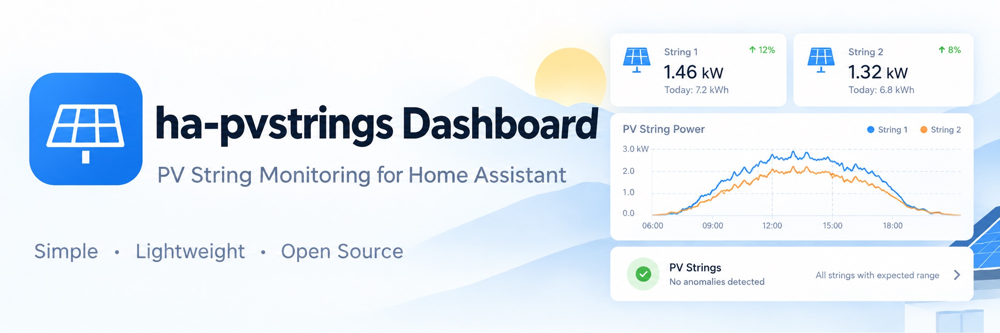
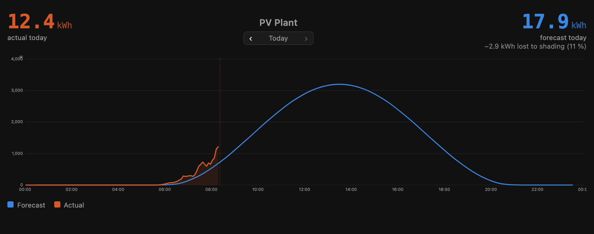
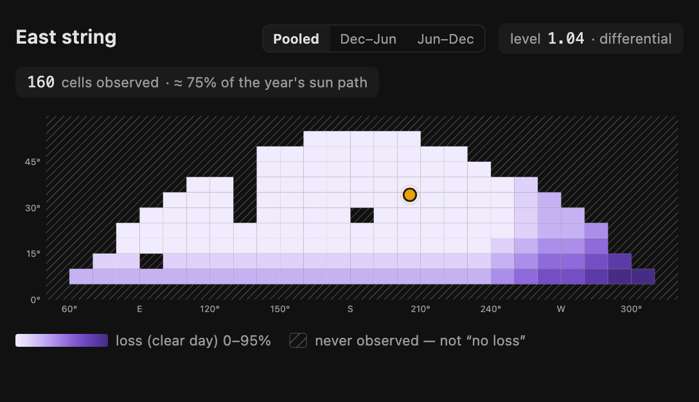
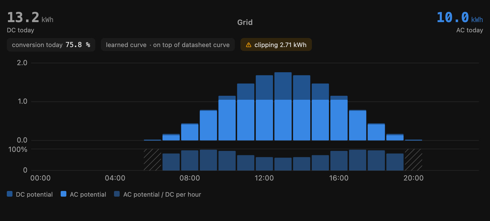
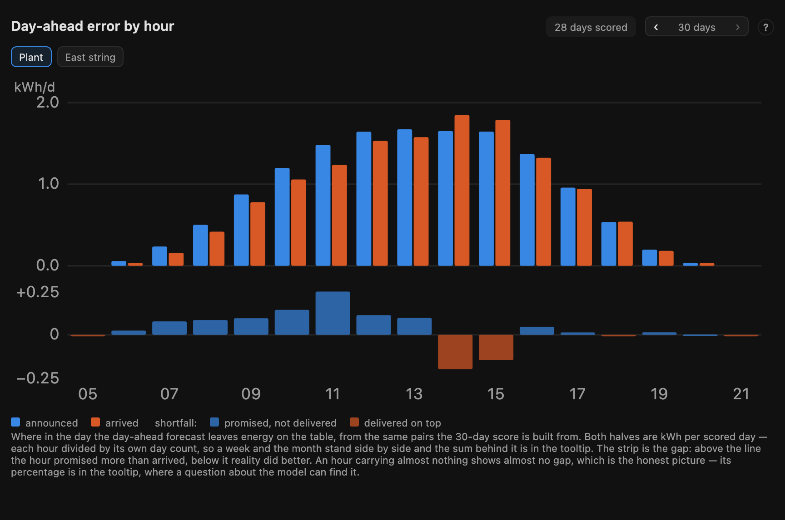

# PV Strings — Dashboard



Dashboard cards for the [PV Strings](https://github.com/doccodyblue/ha-pvstrings)
integration — and a dashboard that builds itself.

**Nothing to install here.** The cards ship inside PV Strings (since 1.26.2) and
register themselves. Install the integration, restart, done. This repository
is where the cards are developed and documented. The dashboard is optional:
the integration publishes everything as ordinary entities and works without it.



## A complete dashboard in one step

Settings → Dashboards → **Add dashboard** → *New dashboard from scratch*. Open
it, choose **Edit** → ⋮ → **Raw configuration editor** and replace everything
with:

```yaml
strategy:
  type: custom:pvstrings
```

You get four views, built from your strings and kept up to date as you add
more:

- **Overview** — today, remaining, tomorrow, live power, savings
- **Strings** — forecast, sky map, shading and yield per string
- **Accuracy** — how good the forecast is, by day and by hour
- **Nerd** — learning progress, correction factors, sensor checks

Every card has a **?** that explains its numbers. German and English follow
your Home Assistant language. Want to adjust it? Take over the generated
config and edit it like any dashboard.

| | |
|---|---|
|  |  |

The sky map is why these cards exist. On the reference plant two strings with
the same orientation and tilt lose 0.3 % and 67.7 % in the same patch of sky —
one has a neighbour's house in its morning. In a table that is noise; as two
maps side by side it is obvious.



*Screenshots show demo data.*

## Cards

All cards also work on their own in any dashboard.

| Card | Shows |
|---|---|
| `pvstrings-forecast` | Forecast, unshaded potential and actual; shading loss of the day |
| `pvstrings-sky-map` | Where in the sun's path a string loses energy |
| `pvstrings-conversion` | DC potential vs. AC or battery charge, clipping |
| `pvstrings-curve` | Learned inverter efficiency vs. datasheet |
| `pvstrings-daily` | Day-ahead forecast vs. actual, day by day |
| `pvstrings-accuracy` | All accuracy figures on one card |
| `pvstrings-hour-profile` | Where in the day the forecast error sits |
| `pvstrings-learning` | What the learning saved, week by week |
| `pvstrings-chain` | What each correction layer did in one hour |
| `pvstrings-nowcast` | Forecast adjusted by your irradiance sensor |
| `pvstrings-sensor-check` | Whether your irradiance sensor can be trusted |
| `pvstrings-calibration` | A calibration trial running beside the live model |
| `pvstrings-thermal` | Modelled cell temperature per string |
| `pvstrings-maturity` | How far the training has come |
| `pvstrings-health` | Data collection and learn cycle status |
| `pvstrings-kv-table` | Small diagnostic tables |

Options and examples for each card: [card reference](docs/cards.md).

## Upgrading from a separate install

Installed this repository on its own before (HACS or `/config/www/`)? Home
Assistant raises a repair: *Dashboard card is loaded from a separate copy*.
Remove that copy (HACS → **PV Strings Dashboard** → ⋮ → **Remove**, or the
`/local/` resource under Settings → Dashboards → ⋮ → Resources) and restart.
Your dashboards keep working; the card names stay the same.

## Documentation

| | |
|---|---|
| [Card reference](docs/cards.md) | The generated dashboard, every card, how to read them |
| [Compatibility](docs/compatibility.md) | Which card needs which integration version |
| [Development](docs/development.md) | Dev loop, screenshots, why this is a separate repository |

## Privacy and licence

The cards draw what PV Strings has published to Home Assistant, plus Home
Assistant's own recorder statistics for the measured series. Nothing is loaded from third parties — no CDN, no web fonts, no telemetry.

Card bugs: this repository's [issues](https://github.com/doccodyblue/ha-pvstrings-dash/issues).
Questions and ideas: the integration's
[Discussions](https://github.com/doccodyblue/ha-pvstrings/discussions).

MIT, see [LICENSE](LICENSE).
