# Card reference

*[README](../README.md) · [Cards](cards.md) · [Compatibility](compatibility.md) · [Development](development.md)*

## Generated dashboard

Settings → Dashboards → **Add dashboard** → *New dashboard from scratch*,
then open it, enter the raw configuration editor (three-dot menu) and replace
the content with:

```yaml
strategy:
  type: custom:pvstrings
```

That is the entire configuration. The strategy reads the entity registry and
builds four views: **Overview** (today, remaining, tomorrow, power, forecast
chart, what arrives behind the inverter, savings — written for people, not for
debugging), **Strings** (one
section per string: forecast line chart, sky map, shading, yield, cell
temperature), **Accuracy** (what learning cost or saved per week where the
integration keeps weeks, one day-by-day chart that switches between the plant and its
strings, and where in the day the forecast leaves energy on the table, in kWh per scored day), and the **Nerd Dashboard** (status
first, numbers on demand: training maturity and a one-line collection health
strip, the correction factors as percentages, the source bias as a heatmap,
what your own irradiance sensor says, whether it can be believed and
what the trial running beside it makes of that,
the modelled cell temperature, the conversion layer with
one chart per group, and
— where a price sensor or a battery makes it meaningful — what the savings
figure rests on). Every card on it carries a **?** with the paragraph that
explains its numbers. All four views show as icons in the tab bar. Views follow `hass.language` (German and English). The
generated YAML is a normal dashboard config — take it over and edit it if you
want to.

The Nerd Dashboard folds tables away where they would only say "healthy": the
skip reasons, the censoring split and the per-string coverage appear when a
figure deviates, and not before. For debugging, the raw view is one line away:

```yaml
strategy:
  type: custom:pvstrings
  diagnostics: full
```

restores every raw table, the accuracy figures (WMAPE and bias, short-term
and day-ahead), the sky-map overview table, the evidence count on every cell
and the explainer footer — and on the Accuracy view lays the six day-by-day charts out side by
side again instead of behind a selector.

## Reading conventions

Four conventions run through all of them, and each one exists to prevent a
specific misreading.

**Hatched means never observed — not "zero".**

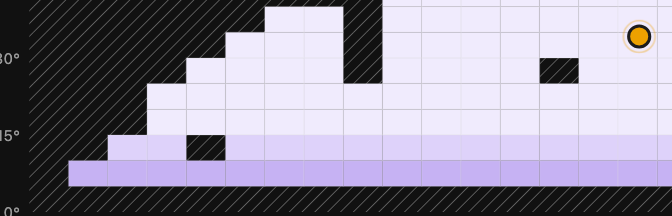

A sky cell the sun has never crossed is hatched rather than painted with the
light end of the loss ramp: "nobody measured this" and "nothing shades this"
mean opposite things, and confusing them once made a broken map look healthy
for two days. The same hatch marks hours whose DC is too small to divide by,
and loads a plant will never reach.

**Dashed means "not the thing itself".**

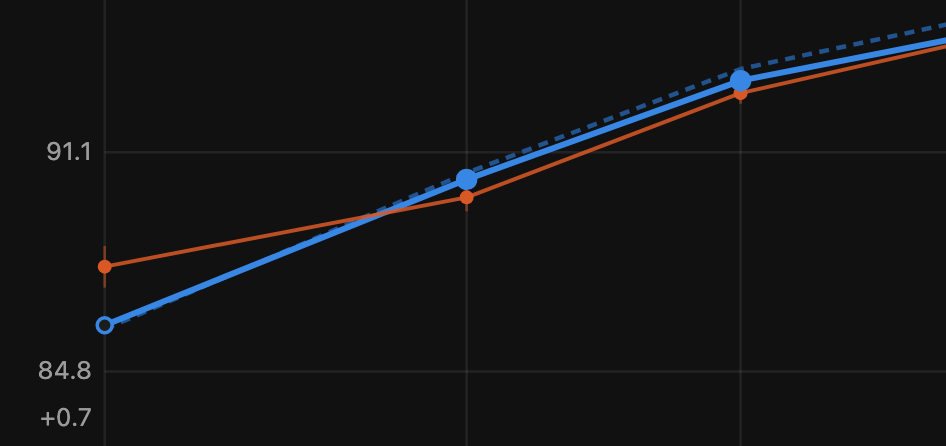

On the conversion-curve card the dashed line is the datasheet prior, the solid
line is what the plant actually applies, and orange is the raw measurement —
blue is the model and orange the measurement, in every card. Filled markers
sit where evidence has moved a support point, hollow ones still hold their
prior. While nothing has moved, the applied curve stays dashed as well: a
solid "learned" line would claim a measurement that has not been accepted.

**A second strip carries what the main scale would hide.**

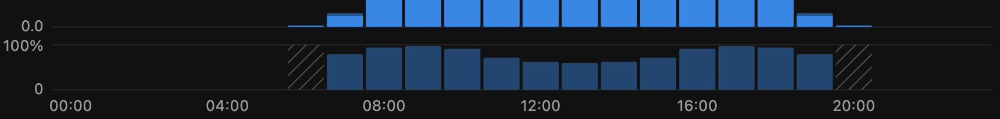

Hourly conversion runs somewhere between 70 and 97 %, which on the energy axis
above would be invisible inside the bars. The strip below has its own 0–100 %
scale: lower at dawn and dusk where the inverter is inefficient, dipping at
midday where clipping cuts the AC — a hardware cap, not a conversion loss,
which is why clipping also gets its own chip. The curve card uses the same
device for its correction in percentage points.

**A withheld figure says how far off it is.**

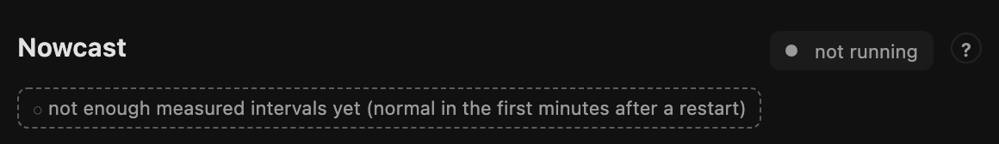

Nothing is ever silently blank. Where a value cannot be shown, its place is
taken by the reason — here the nowcast shortly after a restart, waiting for
enough measured intervals, which is a normal state and not an error. The same
style covers "no cells learned yet", "no learning region built", and every
other not-yet.

## Cards

### `pvstrings-sky-map`

The learned sky as a grid over sun position: ten degrees of azimuth by five of
elevation, only the observed range drawn, with the sun's current position
marked.

```yaml
type: custom:pvstrings-sky-map
entity: sensor.<string>_sky_map      # German installs: sensor.<strang>_himmelskarte
show_sun: true      # optional
seasons: true       # optional — seasonal layer toggle when split cells exist
```

Two things it deliberately gets right, both learned the hard way:

- **A cell nobody has observed is not a cell with no loss.** Unobserved cells
  are hatched neutral — never the light end of the loss ramp.
- **A flat map is meaningless without knowing what it is measured against.**
  The fit level and method are always on the card: a *differential* map is
  fitted against the sibling strings and its losses are clear-day losses; a
  string with no level (single string, or too few shared epochs) says
  *absolute* instead of pretending.

### `pvstrings-forecast`

Hourly forecast, unshaded potential, and actual production — one axis.
The gap between unshaded and forecast is the shadow the model knows; the gap
to the measurement is what it does not.

The line card sums that first gap over the shown day and puts it under the
forecast total: *−2.9 kWh lost to shading (11 %)*. It counts what the learned
sky map takes off — trees, buildings, anything fixed. Clouds are already in
the weather forecast and are not counted. The line is left out below 0.5 %
and on curtailment groups, which carry no unshaded series of their own.

```yaml
type: custom:pvstrings-forecast
entity: sensor.<plant>_forecast_today   # plant, string, or curtailment group
days: 2             # 1–3
style: bars         # or: line
show_unshaded: true
show_actual: true
history: true       # optional — set false to hide the day stepper
```

`style: line` (what the strategy uses for string sections) draws the actual
series from the string's configured power entity via the recorder's
**5-minute statistics** — the high resolution comes from real data, never
from smoothing. Forecast and unshaded stay hourly, drawn as straight
segments. If no 5-minute statistics exist, the card falls back to hourly
means and says so on the card.

**Looking back.** Where the integration offers the `pvstrings.get_day`
service, the card head carries a ‹ day › stepper; a click on the day between
the arrows opens a calendar for jumping further back. A past day is drawn exactly
like today, from the integration's own record rather than from recorder
statistics: the forecast as it stood before each hour, what arrived, and — in
the tooltip — what the evening before had announced. Every forecast card of a
plant follows the same day, so stepping the plant chart back takes the string
charts with it. After a quiet quarter of an hour the cards return to today, so
a wall tablet does not stay on last Tuesday. How far back each part reaches is
the integration's retention, and the card says where a part has run out
(five-minute values, the evening-before forecast) instead of drawing zero.
Groups have no stepper.

### `pvstrings-conversion`

DC potential vs converted output for one inverter group — AC behind the
inverter for `direct` groups, battery charge for `storage` groups (PV
Strings ≥ 1.20 with a configured output path; without one, none of this
exists and none of it is drawn). Below the bars sits a per-hour ratio
strip that makes the conversion curve visible: lower at dawn and dusk,
dipping under clipping. Hours with too little DC for a meaningful
quotient are hatched, not faked.

```yaml
type: custom:pvstrings-conversion
entity: sensor.<gruppe>_restprognose_ac_heute   # or …_akkuladung_heute
dc_entity: sensor.<gruppe>_rest_heute
```

Three semantic guard rails, straight from the integration's contract: AC
and battery charge are never added (different kinds of energy); the AC
figure is hardware potential — capped at the inverter's AC rating, never
at regulatory limits; and clipping is shown as its own chip because a
hardware cap is not a conversion loss. A header chip names what produced
the output figure — datasheet or custom curve, fixed factors with their
applied multiplier, or "unconverted" when no path is configured.

### `pvstrings-nowcast`

The forecast reacting to your own irradiance sensor (PV Strings ≥ 1.21).
The measured clearness of the last quarter hour is blended into the
coming intervals and fades back to the provider's forecast; the card
shows the clearness on a 0–1.1 scale, the weight on the next interval,
and how fast it fades — half-life marked on the curve, reach capped at
two hours.

```yaml
type: custom:pvstrings-nowcast
entity: sensor.<anlage>_einstrahlung_prognose
```

Inactive at night and on plants without a sensor is the normal state,
so the card shows the *reason* rather than an error. The fade curve is
computed from the two published figures and says so — the integration
publishes no per-interval curve.

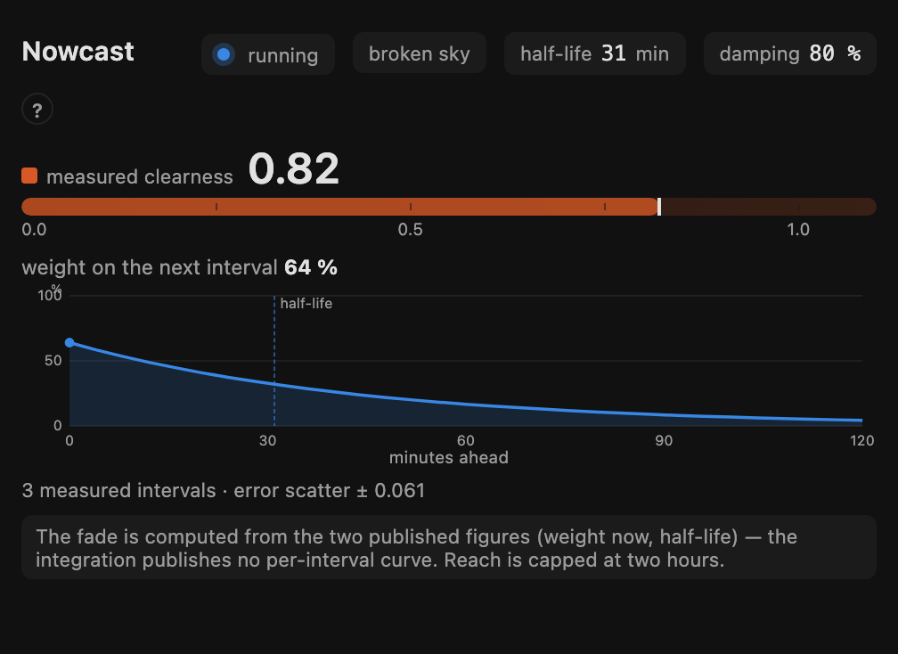

### `pvstrings-sensor-check`

Whether that irradiance sensor is telling the truth (PV Strings ≥ 1.26).
A cheap weather station does not measure irradiance: it measures
illuminance with a diode weighted for the human eye and divides by a
constant, and that constant holds for exactly one reference case — the
lower the sun, the redder its light and the larger the share the diode
never sees. The integration holds every closed hour against an
independent reanalysis archive; the card draws the result per sun
elevation, against 1.0.

```yaml
type: custom:pvstrings-sensor-check
entity: sensor.<anlage>_einstrahlung_prognose
```

The shape is the finding, not the headline number: flat is a calibration
factor, growing towards the horizon is a spectral error, and a gap
between east and west is a sensor that is not level. Bands that have not
gathered a kilowatt-hour of reference across five separate days yet are
drawn as a hatched stub at the baseline — never as a value, and never
left out.

**Nothing on this card corrects the forecast**, and the card says so in
as many words. The nowcast, the source-bias layer and the sky map have
absorbed parts of the same error already; a factor in front of them
would correct it twice.

The card disappears where there is nothing to check — on an older
integration, and on a plant with no irradiance sensor, whose zeros would
otherwise read as a measurement. Banked hours waiting for their
reference are shown as such: the archive runs about a week behind real
time, so a few dozen are the normal state. A plant with no reference at
all is pointed at `pvstrings.backfill_irradiance_check`, with the
warning that only the owner knows whether the sensor stood in the same
place, clean and level, over the period it would read.

### `pvstrings-calibration`

The second model branch, running beside the published one (PV Strings
≥ 1.26, service `pvstrings.calibration_trial`). The irradiance sensor
reads low by an amount that depends on the sun's height, and every layer
the plant has learned was trained while reading it — so a factor in
front of the sensor would correct the same error twice. Instead a whole
second branch reads the sensor through a correction curve and learns its
own model from scratch. Both are scored on the same clear hours.

```yaml
type: custom:pvstrings-calibration
entity: sensor.<anlage>_einstrahlung_prognose
```

The card draws forecast over actual by hour of day for both branches
against 1.0, and under it the two figures the criterion is made of: the
worst hour of the day, and the overall level. The criterion itself was
written down before the trial began — after fifteen clear days the worst
hour has to lose half its error without the level drifting more than
0.02 — and the card says in its own line whether the published forecast
is still the old one. It is, until somebody decides otherwise; nothing
switches itself.

For the first weeks there is nothing to draw but progress, and that is
the state the card is built for. The axes and the reference line are
drawn empty with the reason written inside them, the day count is the
headline, and the blocking reasons that are mere consequences of having
no days yet are not listed at all — three sentences of "no profile, no
level, no days" would read as three faults where there is one clock
still running.

The trial is an option and off by default — the diagnosis costs a few
lines, but the trial costs a second forecast and a second learn cycle
every hour, and that is not something to spend on somebody's plant
without asking. So "not running" means three different things, and the
card keeps them apart. **Switched off** is the interesting one: it shows
what the sensor check found, what a trial would do about it, and where
the switch is — an offer, not a warning, and only where there is a
finding to offer it for. **Switched on but no branch yet** is the day-one
state, or a sensor the check has found straight enough to need no curve.
**No irradiance sensor** removes the card, as does an integration without
the service.

### `pvstrings-curve`

The learned efficiency curve against the datasheet prior it started from
(PV Strings ≥ 1.21). Efficiency over load on a log axis — the shape lives
in the main plot, the correction in a strip below, because learning moves
points by tenths of a percentage point and would be invisible at the
curve's own scale.

```yaml
type: custom:pvstrings-curve
entity: sensor.<gruppe>_restprognose_ac_heute
```

Four states the card keeps apart, because the integration does: learning
switched off (nothing to draw), switched on and collecting (the applied
curve stays dashed — a solid "learned" line would be a lie), learned
(solid line over the dashed prior, filled markers where measurement moved
the point), and refused — when the inverter reports a calculated AC value
instead of a measured one, the fit is blocked and the card says so
calmly, with the flat measurement still on the chart because seeing it
flat is what explains the refusal. Loads the plant has never reached are
hatched, the same grammar the sky map uses for cells the sun never
crossed.

### `pvstrings-chain`

What each layer did to the raw physics for one hour: physics → × sky map →
× per-string model → published, with the measurement beside it. The source
bias is shown as context, not as a link — it was applied upstream and is
already inside the physics figure. So is the heat share (PV Strings ≥ 1.24):
a second italic line names the hour's thermal factor with the modelled cell
temperature, air and wind behind it, and says that it is already inside the
physics figure — multiplying it in again would be exactly the mistake the
integration has a test against. The card also verifies the multiplication it
displays and complains loudly if the invariant does not hold.

```yaml
type: custom:pvstrings-chain
entity: sensor.<string>_forecast_today   # needs the per-string chain attrs
hour: now
```

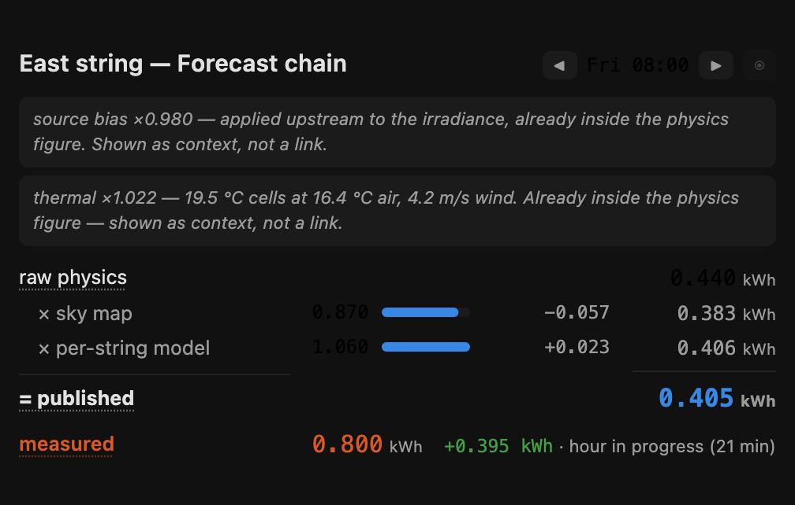

### `pvstrings-daily`

Day-ahead forecast against actual production, day by day. The day-ahead value
comes from the integration's own record — the day-ahead accuracy sensor's
`history` attribute, day by day for the plant and per string — which holds the
very pairs that score is computed from, so the card and the sensor cannot
disagree. (Not `deviation_yesterday`: that one sums every logged hour and the
whole measured day, a slightly different number for the same day.)

Integrations before 1.20.6 do not publish it. There the card falls back to
long-term statistics of `forecast_tomorrow` as recorded in the issue hour
(18:00) of the evening before; that path needs the recorder to keep the entity
and only ever worked because the forecast sensors carried a `state_class`,
which as of 1.20.5 they correctly no longer do. The tooltip says which of the
two a bar came from.

Days without an evening forecast show a hatched "no forecast issued" marker,
never a zero bar.

```yaml
type: custom:pvstrings-daily
entity: sensor.<plant>_forecast_today    # any sensor of the target device
days: 14
```

One card for the plant and every string, switched by chips in the head —
the same chart, one at a time, each entity's data kept once loaded. This is
what the strategy generates; six charts side by side was honest but four
screens tall.

```yaml
type: custom:pvstrings-daily
series:
  - name: Plant
    entity: sensor.<plant>_forecast_today
    days: 14
  - name: East
    entity: sensor.<string>_forecast_today
    days: 14
```

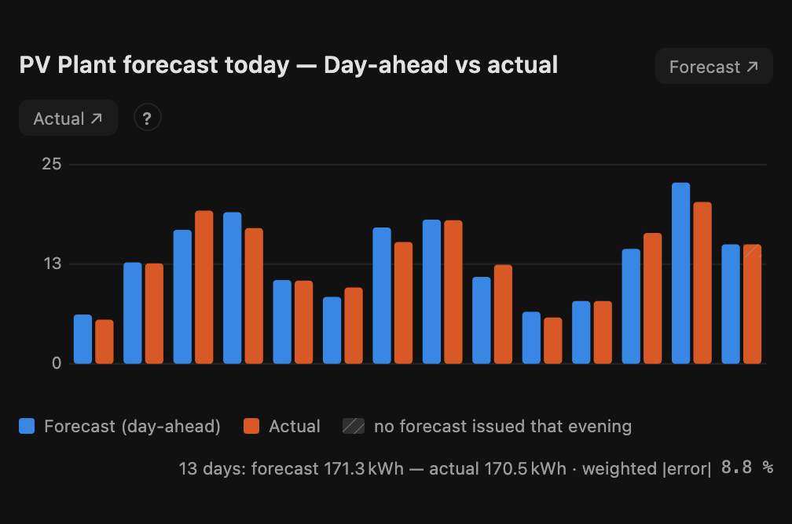

### `pvstrings-accuracy`

The seven accuracy figures as one card: short-term on one line, day-ahead on
the other, each figure with how full its window is — that fill decides
whether the two lines may be compared at all, so it stands under the number
rather than in a paragraph above it. A figure the integration still withholds
shows its day count instead (rule 1); every figure links to its sensor. The
paragraphs that used to open the view — short-term vs day-ahead, what WMAPE
means — sit behind the card's **?**.

Both biases are per day. The `bias_7d` sensor's own state is a mean over
single hours — a few watt-hours, which rounds to zero — so the card takes the
7-day figure per day from the `wmape_7d` sensor's `uncensored.daily_bias_kwh`
attribute and falls back to the state only where that is missing.

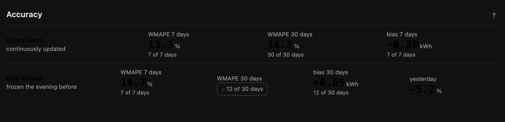

```yaml
type: custom:pvstrings-accuracy
entities:
  wmape_7d: sensor.<plant>_wmape_7d
  wmape_30d: sensor.<plant>_wmape_30d
  bias_7d: sensor.<plant>_bias_7d
  wmape_day_ahead_7d: sensor.<plant>_day_ahead_accuracy_7d
  wmape_day_ahead_30d: sensor.<plant>_day_ahead_accuracy_30d
  bias_day_ahead_30d: sensor.<plant>_day_ahead_bias_30d
  deviation_yesterday: sensor.<plant>_deviation_yesterday
```

### `pvstrings-hour-profile`

Where in the day the day-ahead error sits — the same scored pairs the 30-day
figure is built from, folded by local hour of day. A daily score cannot tell a
morning that runs hot from an afternoon that runs cold, and for anyone sizing a
battery reserve for their own window, that is the whole question.

```yaml
type: custom:pvstrings-hour-profile
entity: sensor.<plant>_day_ahead_accuracy_30_days   # German: ..._genauigkeit_tag_voraus_30_tage
title: Day-ahead error by hour    # optional
```

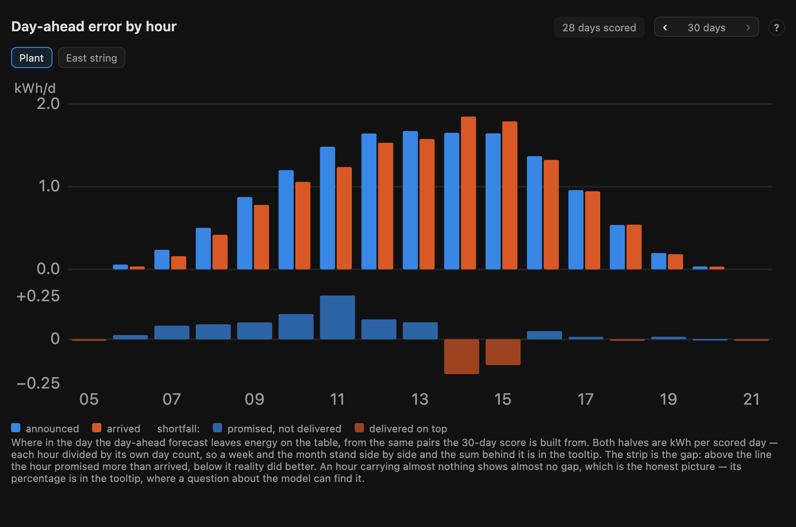

With integration 1.27.1 or later, chips above the chart switch between the
plant and each string. Errors of opposite sign cancel in the plant sum — an
east string announced too high in the morning, a west one too low in the
afternoon — and only show per string. Weeks closed before 1.27.1 have the plant
only; with a string selected, such a week says so instead of drawing the plant
under the string's name.

Two scales, because one would hide the other. The bars carry the energy behind
an hour — announced in blue, arrived in orange. The strip below carries the
deviation as a share of the announcement, `(announced − arrived) / announced`,
which is the number that transfers: it applies as a discount on tomorrow's
window sum, and the integration README shows the same arithmetic as a template.
Above the line means announced too high, so the strip is blue there and orange
below, in the palette every card reads by.

Two things it deliberately gets right:

- **An hour with nothing announced carries no percentage.** Dawn hours where
  the forecast said zero and a trace of yield arrived would divide by zero; they
  keep their bars and skip the strip, because there is no share to be wrong by.
- **A thin hour is dimmed, never dropped**, and when every hour is thin — a
  plant two days old — a chip says so in words. Dimming only reads as dimming
  next to something bright.

The card draws from the first complete day. The accuracy sensor itself stays
`unknown` until three days are in, so the state and the profile disagree by
design; the card follows the profile.

Where the integration offers `pvstrings.get_weeks`, a stepper walks from the
live 30 days back through single weeks — the same fold, one week at a time, so
"did the morning get better" becomes something to step through. A week still
running and a week rebuilt after the fact say so in a chip.

### `pvstrings-learning`

Whether the learning pays: the day-ahead forecast error it avoided, week by
week and added up since the first week compared live. Needs the
`pvstrings.get_weeks` service.

```yaml
type: custom:pvstrings-learning
entity: sensor.<plant>_day_ahead_accuracy_30_days   # any sensor of the plant
title: Learning progress    # optional
```

The comparison is the same integration with learning switched off — same
weather run, same geometry, same hours — not bare physics, because the learned
shading map and source correction are learning too. Errors are summed per day,
like the WMAPE.

Built so that a flattering picture cannot be made from it:

- **A running total, from the first live week.** No window is chosen and no
  live week is left out. Mostly helpful weeks make the line rise on their own; a week where the
  forecast without learning did better bends it down and stays visible; a
  plant where learning achieves nothing draws a flat line.
- **The axis always contains zero**, so "no gain" is always on the chart.
- **"Seen" is not "better".** The thin line is the maturity — how much evidence
  the model holds. It only grows, and it slows every autumn when the sun
  reaches positions the model has not met. A ring marks a week in which a
  weather situation was seen for the first time.
- **Provenance on every week.** The running week is faint, and a week without
  a comparison is a hatched stub, never a zero bar.
- **Rebuilt weeks are shown, not added up.** Weeks from before the integration
  logged the comparison itself set the forecast published back then against
  one computed today without learning — two versions of the code as well, so
  every fix since counts against the learning. They keep a hatched bar and
  their total is named under the chart; until the first live week the card
  says when it starts counting instead of showing a number.

### `pvstrings-kv-table`

Small diagnostic table renderer the Nerd Dashboard is built from. Every
table header links to its source entity. Usable standalone via `mode:` — see
the strategy-generated YAML for examples.

The learning modes (`log_ratio_plant`, `log_ratio_string_all`) print each
learned factor as the percentage it means — **+7 %** reads, 1.068 has to be
converted first — and put the raw factor with its evidence into the hover.
The evidence count stays printed in the cell only while it is thin, or with
`detail: true`; on a mature plant ninety copies of "n 21.8" said nothing the
maturity bar had not already said.

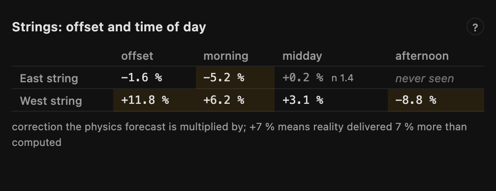

`ghi_bias` draws the source bias by local hour and forecast horizon as a
heatmap in the palette the whole dashboard reads by: blue where the weather
source announced more than arrived (the forecast is scaled down), orange where
it announced too little. Cells resting on thin evidence are hatched and faded.
Sixty numbers hid the one thing the table exists to show — *where* in the day
and at *which* horizon the source runs hot or cold; colour shows it at a glance.

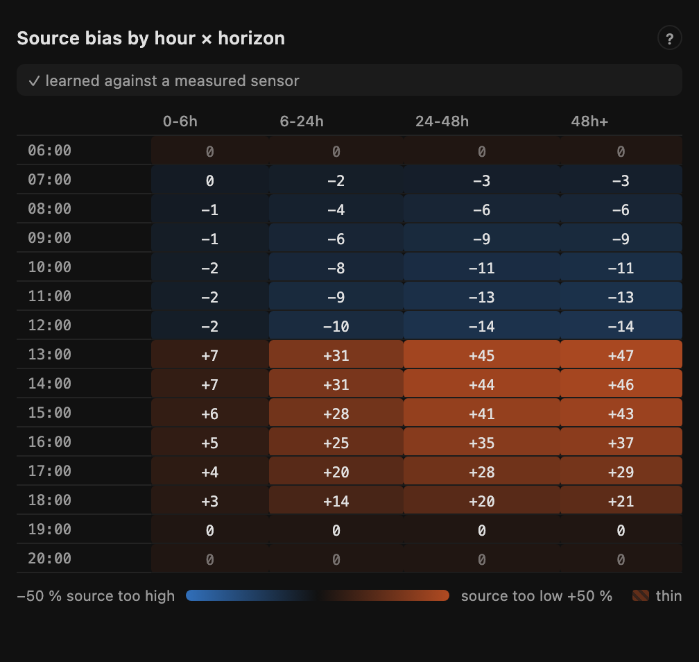

The `price` mode is the one that appears on its own evidence: it shows, per
window, how much of the energy behind the savings figure was valued at a
recorded price and how much fell back to the configured tariff, the
energy-weighted mean prices, and grid export the strings did not make in the
same hour. Each half only appears where the integration publishes it, so a
plant on a fixed tariff with a plain meter never sees the table at all.

### `pvstrings-maturity`

How far the training has come, on two axes with deliberately different
clocks — one blended number would hide exactly that:

- **Weather correction**: the evidence held across all weather × daypart
  buckets, relative to the most a bucket can ever hold. The learning forgets
  slowly, so the count saturates — 100 % means "as learned as it gets",
  not "finished".
- **Shading**: the share of the year's sun path each string has observed
  (the same figure the sky-map card shows per string, aggregated). This one
  can only grow as fast as the calendar moves the sun.

```yaml
type: custom:pvstrings-maturity
entity: sensor.<plant>_model_observations
rows:
  - name: East
    sky: sensor.<string>_sky_map
```

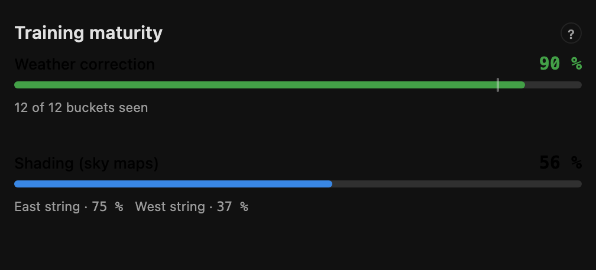

### `pvstrings-health`

Collection and learn cycle as one row of chips. Four tables used to say
"healthy" in thirty numbers; here every figure is a chip that links to its
source entity, and a table opens only where a figure deviates — per-string
coverage when a string falls under 95 %, the skip reasons when the last learn
cycle skipped anything other than night hours, the censoring split when an hour
was a lower bound, reconstructed or curtailed. On a healthy plant the card is one line.

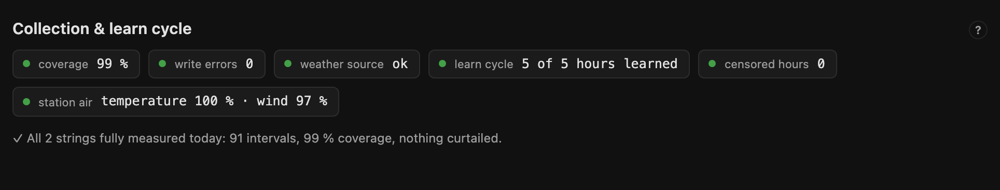

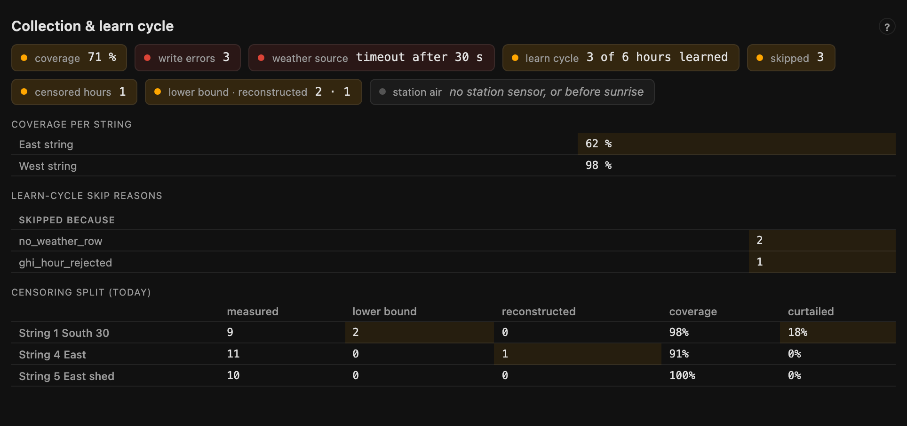

The chips state numbers, never verdicts: "0 skipped" and "no learn cycle
recorded yet" are different chips (grey, not green), and so is a cycle that
found no new hour to learn from. With PV Strings ≥ 1.24 a *station air* chip
shows the share of today's daylight intervals for which the configured
temperature and wind sensors delivered a value — the check that measured air
actually reaches the physics.

```yaml
type: custom:pvstrings-health
entity: sensor.<plant>_collection_coverage
model_entity: sensor.<plant>_model_observations   # learn cycle, skip reasons
detail_entity: sensor.<plant>_strings             # censoring split
ghi_entity: sensor.<plant>_irradiance_forecast    # station air share
detail: false                                     # true: every table, always
```

### `pvstrings-thermal`

The modelled cell temperature over the day, one line per string, the air as a
thin dashed line — the distance between the two is irradiance and wind. A
dotted line marks the 25 °C the factor is measured against. Below the chart,
what the heat costs: the running hour's effect and today's sum, from the cell
temperature sensor PV Strings ≥ 1.24 publishes per string. The chip in the
head is the plant's share today, energy-weighted over the strings (Σ physics /
Σ physics ÷ thermal — never a mean of factors).

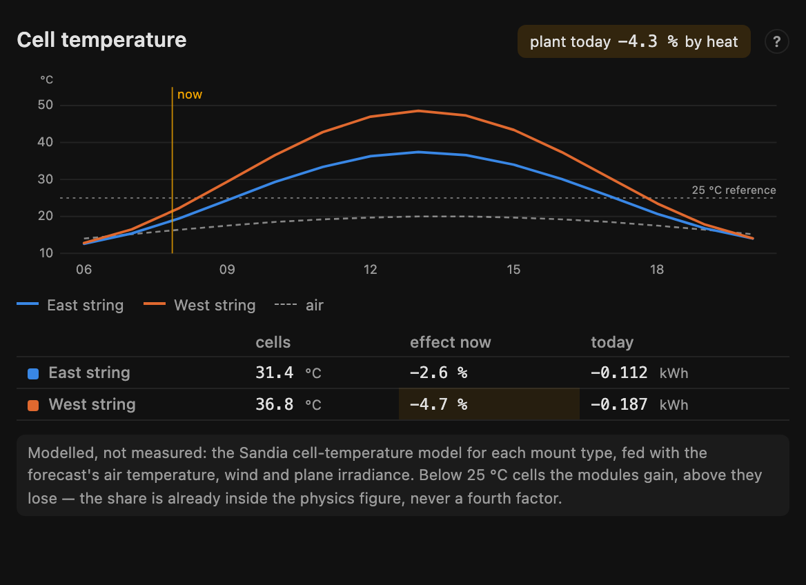

Modelled, not measured, and the card says so: the Sandia cell-temperature
model for each mount type, fed with the forecast's air temperature, wind and
plane irradiance. A flat, insulated mount runs visibly hotter than an open
rack at the same air. The share is already inside the physics figure of the
forecast chain — the chain card shows it as context, in the same italic line
as the source bias, never as a fourth factor.

```yaml
type: custom:pvstrings-thermal
rows:
  - name: East
    forecast: sensor.<string>_forecast_today      # chain rows carry thermal
    cell: sensor.<string>_cell_temperature        # optional: table row
```

## Nerd dashboard

Every card carries a **?** with this in short. The longer version:

- **Correction factors**: the physics forecast is multiplied by them — +7 %
  means reality delivered 7 % more than computed. The plant learns separately
  per weather class and time of day; *never seen* means this weather has not
  occurred at that time yet, which is itself a finding. Per string, an offset
  and a daypart layer sit on top; since integration 1.20.1 every bucket is
  published from its first observation and pulled towards 0 % by how little
  evidence stands behind it — half strength at about ten observations. A
  factor near 0 % with a small n is thin, not switched off.
- **Source bias**: the weather source's systematic error per local hour and
  forecast horizon, as a correction on irradiance. *Measured* means learned
  against a real sensor; *nowcast* only against the source's own short-horizon
  run — a much weaker claim.
- **Sky maps**: *level* is the string's clear-view yield relative to physics.
  Where strings share enough epochs the map is fitted against the sibling
  strings (*differential*); a single string fits *absolutely* and has no
  level. On a differential map each cell's loss is the clear-day loss; at
  runtime the integration scales it by the direct-light share, so an overcast
  day loses almost nothing.
- **Nowcast**: the forecast reacting to your own irradiance sensor — the
  measured clearness of the last quarter hour blended into the coming
  intervals, fading back to the provider's forecast with a half-life that
  depends on how broken the sky is. Next to the measured clearness (orange)
  the card marks what the weather source expects for now (blue) — the gap is
  what gets corrected. Inactive at night and without a sensor is
  the normal case; then the reason is the interesting figure. Not the same
  word as *nowcast* in the source-bias table.
- **Sensor check**: the same sensor, graded against an independent reanalysis
  archive per sun elevation. 1.0 is agreement; a flat error is a calibration
  factor, one that grows towards the horizon is a spectral error, and an
  east-west gap is a sensor that is not level. Bands without a kilowatt-hour
  of reference across five days are hatched stubs, not values. None of it
  corrects the forecast — parts of the same error are already absorbed
  elsewhere in the chain.
- **Calibration trial**: a second, complete model branch reading the same
  sensor through a correction curve and learning its own model from scratch.
  Both branches are scored on the same clear hours; the card shows forecast
  over actual by hour of day against 1.0, plus the worst hour and the level
  the pre-registered criterion is made of. The published forecast stays the
  existing one until the criterion says otherwise, and the card says so in
  its own line. An empty chart means the trial is still collecting clear
  days — the day count beside it says how many.
- **Collection**: coverage is the share of 5-minute intervals actually
  captured, counted over daylight hours only. *Lower bound* marks hours where
  the inverter was curtailed — real yield would have been higher. **Skip
  reasons** are what the learn cycle deliberately did not learn from; on a
  plant learning nothing, that list is the entire diagnosis.
- **Training maturity**: the weather bar is the evidence held across all
  weather × daypart buckets, relative to the most a bucket can hold — 100 %
  means "as learned as it gets", not "finished". The shading bar is the share
  of the year's sun path each string has observed; it grows no faster than
  the calendar.
- **Cell temperature**: modelled per string from the forecast's air, wind and
  plane irradiance. Cells above 25 °C lose output, below they gain; the effect
  is already inside the physics figure.
- **Conversion**: AC is energy behind the inverter, capped at its AC rating
  when clipping applies but never at regulatory limits; battery charge is DC
  into the storage — the two are never added. *Unconverted* means no curve
  configured, not a measured 0 % loss.
